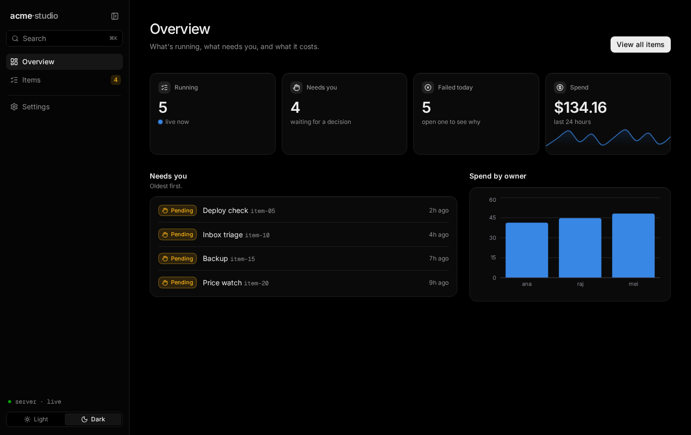
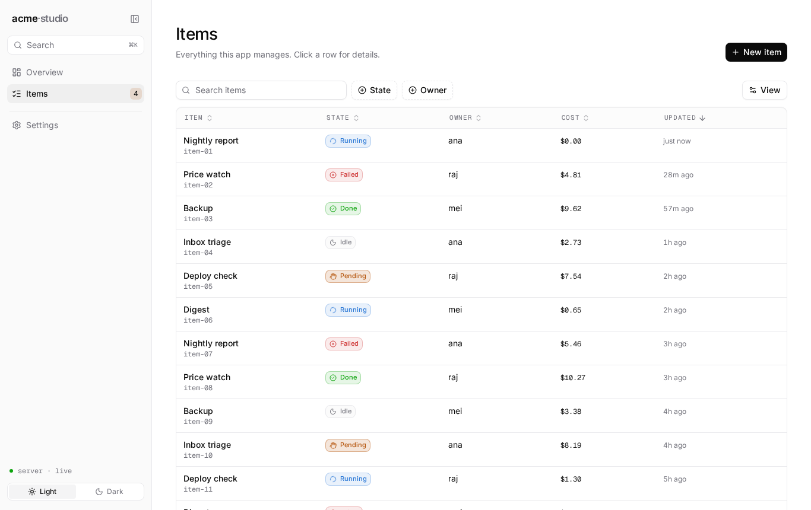
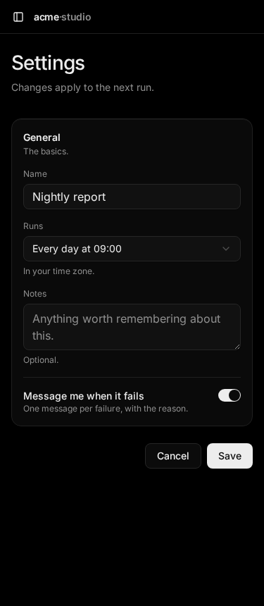

# studio-ui

A [Claude Code](https://claude.com/claude-code) skill for building operator-facing web UIs — dashboards, consoles, admin panels — from scratch, in the visual language of [Sandbox Studio](https://github.com/Amitgb14/sandbox-cli).



| Light | Phone |
|---|---|
|  |  |

## What you get

- **A runnable starter**: React 19, Vite, Tailwind 4, shadcn (new-york), lucide icons, Recharts, TanStack Table.
- **A design system**:
  - near-monochrome and dark-first, with an optional light mode
  - Inter and Geist Mono
  - colour reserved for status, meaning and data, with colour-blind-safe chart colours
- **The app shell**: collapsible sidebar, ⌘K command palette, light/dark switch, phone layout.
- **Building blocks**: data table (search, filters, sorting, paging), stat tiles with sparklines, status badges, empty states, key/value panels, forms, confirm dialogs.
- **Example pages**: overview, list, detail with tabs, settings form.
- **Written rules**: design, page patterns and UI wording, so Claude stays consistent as the app grows.

## Install

In Claude Code:

```
/plugin marketplace add Amitgb14/studio-ui
/plugin install studio-ui@studio-ui
```

Or from your shell: `claude plugin marketplace add Amitgb14/studio-ui && claude plugin install studio-ui@studio-ui`.

Then, in your project, ask for a dashboard, console or admin panel ("build a web UI in ./web for this API") and the skill loads on its own, or run `/studio-ui:build`. Get updates with `/plugin marketplace update studio-ui`.

> **Upgrading from the old skill folder?** If you cloned this repo into `~/.claude/skills/studio-ui`, remove that folder (`rm -rf ~/.claude/skills/studio-ui`) and install the plugin as above. A clone there no longer loads as a skill.

## Scaffold an app yourself

Claude runs the scaffold for you when you use the skill. To run it by hand, clone the repo anywhere (not into `~/.claude/skills`) and use the `scaffold.sh` at its root:

```sh
git clone https://github.com/Amitgb14/studio-ui ~/src/studio-ui

# A new folder:
bash ~/src/studio-ui/scaffold.sh ./my-app acme "Acme Console"

# A UI inside an existing project, in its own subfolder:
cd my-project && bash ~/src/studio-ui/scaffold.sh ./web acme "Acme Console"

# The current folder, if it's a fresh repo (only .git, README, LICENSE, .gitignore):
bash ~/src/studio-ui/scaffold.sh . acme "Acme Console"
```

Then `cd` into the folder and run `npm install && npm run dev`.

- **`app-key`** (`acme`) is lowercase. It becomes the wordmark (`acme·studio`), the package name and the theme's storage key.
- **The title** (`"Acme Console"`) is the browser tab title.
- **Nothing is overwritten.** The script refuses a folder that already has a project in it, never replaces an existing file, and adds its lines to an existing `.gitignore`.
- **Platforms:** it works on macOS and Linux with the stock tools.

The example pages run on sample data in `src/lib/sample-data.ts`. Replace it with calls to `api()` from `src/lib/api.ts`.

## Layout

```
scaffold.sh                               shortcut to the scaffold script below
.claude-plugin/marketplace.json           the marketplace (one plugin)
plugins/studio-ui/
  .claude-plugin/plugin.json              the plugin manifest
  skills/build/
    SKILL.md                              instructions Claude follows
    references/                           design-system.md, patterns.md, voice.md
    scripts/scaffold.sh                   copy the starter and fill in names
    assets/template/                      the starter app
```

## License

MIT
